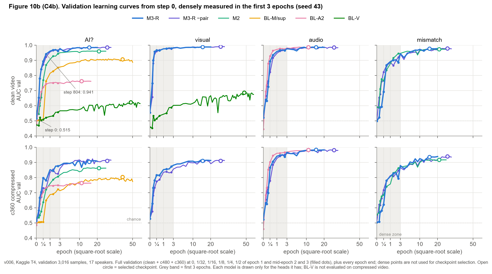

# v006 — Seed 43 replication of v005, with dense validation

Closed **14 November 2026**. v006 retrains the full v005 roster with seed 43 and tests it once on Kaggle. The code, data, training recipe and test set are unchanged from v005, which is described in [`v005_report.md`](v005_report.md). The only additions are extra validation points inside the first three epochs.

This report covers only what v006 adds:
- the dense learning curves;
- the seed-to-seed comparison;
- the two v005 conclusions that do not replicate.

Files:
- Generated report: [`v006_results/report.md`](v006_results/report.md) (in Vietnamese).
- Gates: [`v006_results/gates.json`](v006_results/gates.json).
- Test-use log: [`v006_results/test-log.json`](v006_results/test-log.json).

Evidence marks:
- **●** measured on our data;
- **○** inference, not checked.

Numbers without a mark are ● on the shared test set (3 parts, 31 unseen speakers, 7,368 clips).

---

## 0. Summary

- **The main result replicates.**
  - M3-R reaches AI? AUC 0.971 / 0.960 / 0.907 (clean / 480p / 360p), against 0.973 / 0.962 / 0.914 with seed 42.
  - Gates R1, R2, R2b and R3 pass again, with every CI above 0.
  - Per-model AUCs differ by at most 0.009 between seeds. The gaps between M3-R and the baselines are 0.04–0.07.
- **The consistency-loss gain does not replicate.** R6 (M3-R − M3-R without pairing, 480p) was +0.004 [+0.001; +0.006] with seed 42 and is −0.001 [−0.004; +0.002] with seed 43. Paired clean ↔ re-encoded training does not justify twice the GPU time.
- **Audio non-inferiority is borderline.**
  - R8 is −0.001 [−0.01004; +0.007] against a −0.01 margin, so it formally fails by 0.00004.
  - Across both seeds (+0.004, −0.001), M3-R's audio head is level with BL-A2. It is not shown to be non-inferior.
- **The learning curves now start at chance level.**
  - With validation from step 0, every model starts at AI? AUC 0.47–0.56.
  - M3-R climbs to 0.941 by half of epoch 1 (step 804).

## 1. What changed

| | v005 | v006 |
|---|---|---|
| Seed | 42 | 43 (`settings.SEEDS`) |
| Run / W&B project | `train_all_v005` / `vn-av-df-v005` | `train_all_v006` / `vn-av-df-v006` |
| Validation | end of every epoch | also at 0, 1/32, 1/16, 1/8, 1/4 and 1/2 of epoch 1, and mid-epoch 2 and 3 (`training.dense_val`) |
| Model, data, recipe, test set | | unchanged (the unused appearance stream is kept so that both seeds share one architecture) |

Rules for the dense points (`train.py`: `dense_schedule`, `dense_probe`, `kept_rng`):
- Each dense point runs the full validation: clean, c480 and c360.
- They are stored in `history.json` → `dense` and logged to W&B as `dense/*` against `train/steps`.
- They are never used for checkpoint selection, the scheduler or early stopping.
- The RNG state (torch CPU/CUDA, `random`, `numpy`) is restored after each point.
- `tests/test_pipeline.py::test_dense_validation_points_do_not_change_training` checks this. It trains with and without dense points and gets identical losses, metrics, best epoch and `best.pt` tensors.
- Cost (●): 1.4 h each for M3-R and M3-R without pairing, and at most 0.6 h for each baseline.

## 2. Training on Kaggle

| Session | Commit | Result (●) |
|---|---|---|
| P1 | `dadda36` | Finished: BL-A2 and BL-V. Time limit hit: M3-R; BL-M/sup at epoch 46; M2 at epoch 1 |
| P2 | `dadda36` | Finished: M3-R (early stop, 20 epochs, best epoch 15, selection metric 0.9675), M2, BL-M and SpeechForensics. M3-R without pairing hit the time limit at epoch 20 |
| P3 | `394fe2d` | Finished: M3-R without pairing (30 epochs, the maximum; best epoch 27, 0.9682) and BL-M/sup (early stop, 50 epochs, best epoch 40) |
| test | `394fe2d` | 8 models × 3 levels; each model used the test set once (`test-log.json`) |

- **P3 schedule change.** P2 had no BL-M/sup step, so the P3 schedule was changed from (M3-R, no-pair) to (no-pair, BL-M/sup).
- **GPU hours** (epochs plus dense points, ●):

  | Model | GPU hours |
  |---|---|
  | M3-R | 21.1 |
  | M3-R without pairing | 15.6 |
  | BL-M/sup | 12.0 |
  | M2 | 5.7 |
  | BL-V | 5.3 |
  | BL-A2 | 4.7 |
  | BL-M | 0.6 |

  Compared with v005:
  - BL-M/sup ran 50 epochs instead of 24 before early stopping.
  - M3-R without pairing ran all 30 epochs, against 29 in v005.

Validation AUC from step 0, by output head (columns) on clean and 360p video (rows).
- The x axis is in epochs on a square-root scale. The grey band marks the first 3 epochs, and filled dots are dense points.
- The open circle marks the tested checkpoint.

What the curves show:
- **M3-R** goes from 0.515 at step 0 to 0.779 at step 100, 0.894 at step 402 and 0.941 at step 804, all on clean AI?. Most of the clean-video learning happens in the first half of epoch 1. Later epochs mainly improve 360p.
- **BL-M/sup** stays at 0.50–0.51 for the first quarter of epoch 1 (3,214 steps) before it rises. End-of-epoch validation hides this slow start.
- **BL-V** stays at 0.47–0.56 through the first 3 epochs, consistent with its low test AUC.

## 3. Results: seed 42 against seed 43

AI? AUC on test, clean / 480p / 360p:

| Model | Seed 42 (v005) | Seed 43 (v006) |
|---|---|---|
| **M3-R** | 0.973 / 0.962 / 0.914 | 0.971 / 0.960 / 0.907 |
| M3-R without pairing | 0.972 / 0.959 / 0.911 | 0.973 / 0.961 / 0.910 |
| BL-Ens-AV | 0.935 / 0.913 / 0.848 | 0.929 / 0.904 / 0.849 |
| M2 | 0.930 / 0.907 / 0.851 | 0.933 / 0.909 / 0.855 |
| BL-M/sup | 0.876 / 0.848 / 0.771 | 0.871 / 0.841 / 0.777 |
| BL-A2 | 0.744 / 0.744 / 0.735 | 0.753 / 0.752 / 0.741 |

Pre-registered gates (ΔAUC, speaker-bootstrap 95% CI, 1,000 resamples, 31 speakers):

| Gate | Comparison | Seed 42 | Seed 43 | Across seeds |
|---|---|---|---|---|
| R1 | M3-R − BL-Ens-AV, clean | +0.039 [+0.033; +0.044] | +0.042 [+0.034; +0.052] | passes in both |
| R2 | M3-R − BL-Ens-AV, 480p | +0.050 [+0.043; +0.056] | +0.055 [+0.043; +0.069] | passes in both |
| R2b | M3-R − BL-Ens-AV, 360p | +0.065 [+0.051; +0.079] | +0.059 [+0.040; +0.078] | passes in both |
| R3 | M3-R − M2, 480p | +0.055 [+0.046; +0.065] | +0.051 [+0.041; +0.060] | passes in both |
| R6 | M3-R − M3-R without pairing, 480p | +0.004 [+0.001; +0.006] | −0.001 [−0.004; +0.002] | **does not replicate** |
| R8 | M3-R − BL-A2, audio, unseen voices, 480p (margin −0.01) | +0.004 [−0.004; +0.013] | −0.001 [−0.010; +0.007] | **level; seed 43 fails by 0.00004** |

Other results that hold with seed 43:
- **Operating point.** The threshold is set at 5% FPR on clean real validation. M3-R flags 1.0% / 1.7% / 10.4% of real test clips at clean / 480p / 360p, and catches 81.6% / 79.8% / 77.5% of fakes.
  - Seed 42 flagged 1.5% / 2.1% / 8.5%.
  - **360p at a fixed threshold remains the main operating weakness.**
- **Delayed audio.** Real clips with audio shifted by k frames should not look fake; 0.5 means unaffected.
  - Shifted against unshifted real AUC for M3-R: 0.482 / 0.483 / 0.492 at k = 2 / 3 / 4.
  - For M3-R without pairing: 0.527 / 0.548 / 0.568.
  - Seed 42 gave 0.518 / 0.521 / 0.529 for M3-R and 0.573 / 0.602 / 0.625 without pairing.
  - So pairing makes the model a little less sensitive to audio delay in both seeds. This is the one replicated effect of pairing.
- **Unseen voices remain the weakest case:** VoxCPM2 0.896 and F5 inpainting 0.883 (seed 42: 0.905 and 0.911).

## 4. Conclusions after two seeds

1. **M3-R is better and more robust than every baseline.** This holds on both seeds, with margins about 5–10 times the seed-to-seed spread.
2. **The benefit of the consistency loss is not established.** Its effect sits within the seed-to-seed spread. Unless a third seed disagrees, M3-R without pairing is the better trade-off: about the same AUC for roughly 70% of the GPU time (15.6 h vs 21.1 h here) ○.
3. **M3-R's audio head is level with a dedicated voice detector**, but strict non-inferiority at −0.01 is not shown.

## 5. Limitations

- **Two seeds** give a first look at seed variance, not a reliable standard deviation.
- **CIs cover speaker sampling only.**
- **Not evaluated in this round:**
  - `pr`, `w360` and `c288`: these caches were never prepared, as in v005;
  - optional gates R4, R5 and R2c.
- All other v005 limitations still apply. See [`v005_report.md`](v005_report.md) §7.

## 6. Reproducing

- Sessions: `P1` → `P2` (`PREVIOUS_RUN` = P1) → `P3` (`PREVIOUS_RUN` = P2) → `GROUP = "test"` (`PREVIOUS_RUN` = P3).
  - Kaggle notebooks are named `vn-av-df-train-v006-<p1|p2|p3|test>` and generated by `tools/make_notebooks.py`.
  - Each notebook attaches the 3 data parts, the 21 prepare outputs and the previous session's output.
- **Runs must be started from the Kaggle web editor.** Versions pushed through the Kaggle API cannot read the attached `WANDB_API_KEY` secret ●.
